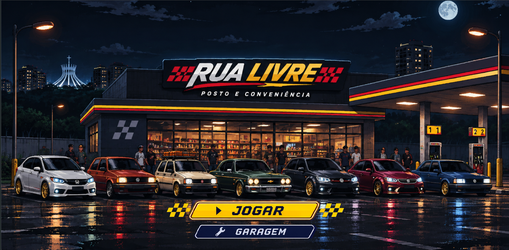

# Rua Livre

> **Um arcade de corrida brasileiro que combina a energia dos clássicos de 8/16 bits com uma arquitetura web moderna, modular e testável.**

O **Rua Livre** é um jogo de corrida pseudo-3D executado diretamente no navegador. O projeto recupera a sensação de velocidade, as curvas expressivas e o multiplayer local dos arcades clássicos, mas constrói uma identidade própria com carros populares, paisagens brasileiras, progressão e uma direção de arte em pixel art.

Este repositório representa um projeto autoral, acadêmico e experimental desenvolvido com HTML, CSS, JavaScript ES Modules e Canvas 2D, sem depender de um motor comercial.

## Visão geral

| Característica | Estado atual |
| --- | --- |
| Plataforma | Navegadores modernos em computadores |
| Modos de jogo | Corrida solo e versus local |
| Jogadores simultâneos | Até 2 no mesmo computador |
| Carros jogáveis | 10 |
| Rivais competitivos | 3 |
| Tráfego civil | 12 veículos com velocidades variadas |
| Circuito atual | Brasília — Circuito do Cerrado |
| Estrutura da corrida | 3 voltas em uma pista de 1,68 km |
| Cenário dinâmico | 5 trechos temáticos contínuos |
| Qualidade | 82 testes automatizados do jogo |

## Proposta do projeto

Jogos de corrida retrô costumam representar veículos, cidades e referências estrangeiras. O Rua Livre explora como essa linguagem pode ser reinterpretada com elementos próximos do público brasileiro, sem copiar código, sprites ou músicas de títulos comerciais.

Do ponto de vista acadêmico, o projeto integra:

- programação de jogos e simulação em passo fixo;
- matemática de projeção pseudo-3D;
- desenho e animação em Canvas 2D;
- design de interfaces e experiência do usuário;
- tratamento de sprites e pixel art;
- áudio interativo com Web Audio API;
- persistência local;
- arquitetura modular e testes automatizados;
- versionamento e documentação técnica.

## Evolução desde o protótipo

| Dimensão | Primeiro protótipo | Versão atual |
| --- | --- | --- |
| Estrutura | Corrida concentrada em uma página | Sistemas separados por responsabilidade |
| Pista | Estrada desenhada diretamente no canvas | Segmentos pseudo-3D, curvas, relevo e profundidade |
| Veículos | Três opções iniciais | Dez carros jogáveis, rivais e tráfego civil |
| Mecânicas | Acelerar, frear e virar | Nitro, integridade, buracos, derrapagem, colisões e preparação |
| Modos | Um jogador | Solo e versus local em tela dividida |
| Cenário | Panorama com laterais vazias | Objetos projetados e cinco zonas progressivas |
| Interface | HUD provisório | Velocímetro, minimapa, cronômetro e barras de status |
| Áudio | Trilha inicial | Música e motor dinâmico em três camadas |
| Persistência | Sem progressão consolidada | Créditos, recordes, carro e preparação salvos |
| Validação | Testes manuais do conceito | 82 testes automatizados do jogo |

O histórico detalhado de decisões e mecânicas está em [Evolução do protótipo](docs/evolucao-do-prototipo.md).

## Experiência de jogo

O fluxo atual é:

**Tela inicial → Escolha do modo → Garagem → Preparação → Corrida → Resultado**

Na corrida solo, o objetivo é completar três voltas, disputar posição com os rivais, atravessar o tráfego e preservar a integridade do veículo. O resultado concede créditos que podem ser usados na preparação do carro. Uma prova sem colisões recebe um bônus adicional.

No versus local, duas pessoas competem no mesmo computador. Cada jogador possui câmera, carro, integridade, nitro e coleta de itens independentes, enquanto rivais e tráfego permanecem compartilhados.

### Mecânicas principais

- **Pilotagem arcade:** aceleração direta, frenagem, força lateral em curvas e derrapagem em alta velocidade.
- **Nitro:** aumenta temporariamente aceleração e velocidade máxima; pode ser recuperado por itens na pista.
- **Integridade:** colisões, barreiras e buracos causam danos diferentes e podem encerrar a corrida.
- **Colisões sólidas:** o jogador não atravessa carros à frente e perde velocidade após o impacto.
- **Rivais e tráfego:** três adversários definem a classificação; doze veículos civis criam situações de ultrapassagem.
- **Progressão:** créditos, recordes, seleção do carro e estágio de preparação permanecem salvos no navegador.
- **Preparação:** três estágios aumentam velocidade, aceleração e controle sem permitir compras duplicadas.
- **Cenário em perspectiva:** vegetação, postes, placas, defensas e marcos usam a mesma projeção da pista.
- **Partículas ambientais:** poeira e pétalas reforçam a velocidade e a identidade das zonas do circuito.

## Garagem e frota

A garagem funciona como centro de seleção e preparação. Ela apresenta o carro sobre uma plataforma, informações do modelo, atributos, créditos disponíveis e estado das melhorias.

Carros disponíveis:

1. UP TSI
2. Chevette
3. Vectra GLS
4. Civic G8
5. Gol Quadrado
6. Jetta
7. Marea
8. Opala
9. Santana
10. Uno Mille

Os veículos possuem sprites e perfis de áudio próprios. No estado atual, compartilham os mesmos atributos básicos de desempenho; a diferenciação física por modelo faz parte do planejamento futuro.

### Preparação

| Estágio | Custo | Velocidade máxima | Aceleração | Controle |
| --- | ---: | ---: | ---: | ---: |
| 1/3 | Inicial | 190 km/h | 68 | 1,280 |
| 2/3 | R$ 500 | 198 km/h | 73 | 1,305 |
| 3/3 | R$ 900 | 206 km/h | 78 | 1,330 |

Motor e pneus representam efeitos já conectados à simulação. A categoria de acerto individual permanece identificada como expansão futura e ainda não altera a física.

## Brasília — Circuito do Cerrado

O circuito utiliza um gerador determinístico: a mesma pista e a mesma semente produzem a mesma distribuição de objetos em todas as corridas. Os elementos são associados a posições reais do mundo, crescem conforme se aproximam da câmera e acompanham curvas e relevo.

A volta é dividida em cinco trechos:

| Progresso | Trecho | Direção ambiental |
| ---: | --- | --- |
| 0–18% | Cerrado | Vegetação seca, árvores retorcidas, pedras e poeira |
| 18–40% | Avenida dos Ipês | Ipês amarelos e roxos, flores, postes e pétalas |
| 40–65% | Eixo Monumental | Placas, defensas, canteiros e referências urbanas |
| 65–85% | Orla do Paranoá | Vegetação baixa, guarda-corpos e paisagem aberta |
| 85–100% | Reta da Capital | Bandeiras, barreiras, arquibancadas e pórtico |

As transições misturam progressivamente a distribuição das zonas. Objetos visíveis não são trocados quando o jogador cruza um limite.

Para inspecionar a geração do cenário, acrescente <code>?debugScenery=1</code> ao endereço do jogo. O painel mostra trecho atual, progresso da volta, quantidade de objetos visíveis e FPS.

## Controles

### Corrida solo

| Ação | Teclas |
| --- | --- |
| Acelerar | <kbd>W</kbd> ou <kbd>↑</kbd> |
| Frear e iniciar derrapagem | <kbd>S</kbd> ou <kbd>↓</kbd> |
| Virar | <kbd>A</kbd> e <kbd>D</kbd> ou <kbd>←</kbd> e <kbd>→</kbd> |
| Nitro | <kbd>Espaço</kbd> ou <kbd>Shift</kbd> |
| Pausar | <kbd>P</kbd> ou <kbd>Esc</kbd> |

### Versus local

| Jogador | Acelerar/frear | Virar | Nitro |
| --- | --- | --- | --- |
| Jogador 1 | <kbd>W</kbd> / <kbd>S</kbd> | <kbd>A</kbd> / <kbd>D</kbd> | <kbd>Espaço</kbd> |
| Jogador 2 | <kbd>↑</kbd> / <kbd>↓</kbd> | <kbd>←</kbd> / <kbd>→</kbd> | <kbd>Enter</kbd> |

<kbd>P</kbd> ou <kbd>Esc</kbd> pausa a partida inteira.

## Arquitetura

O jogo mantém um único loop principal. A simulação avança em passos fixos de <code>1/60</code> de segundo, enquanto a renderização acompanha os quadros disponíveis no navegador.

~~~mermaid
flowchart LR
    A[Interface e navegação] --> B[Estado da partida]
    B --> C[Simulação em passo fixo]
    C --> D[Pista e projeção]
    C --> E[Física, rivais e colisões]
    C --> F[Persistência]
    D --> G[Renderizador Canvas 2D]
    E --> G
    G --> H[HUD e tela dividida]
    I[Entrada por teclado] --> C
    J[Áudio dinâmico] <--> C
~~~

Responsabilidades principais:

| Caminho | Responsabilidade |
| --- | --- |
| <code>js/main.js</code> | Navegação, estados de tela e ciclo principal |
| <code>js/race.js</code> | Estado e atualização da corrida |
| <code>js/track.js</code> | Construção do circuito e segmentos |
| <code>js/renderer.js</code> | Pista, carros, cenário, partículas e HUD |
| <code>js/versus.js</code> | Simulação para dois jogadores |
| <code>js/audio.js</code> | Música, efeitos e motor em camadas |
| <code>js/storage.js</code> | Créditos, recordes e preferências |
| <code>js/scenery/manifest.js</code> | Atlas, recortes, âncoras e dimensões |
| <code>js/scenery/brasilia-zones.js</code> | Regras das cinco zonas ambientais |
| <code>js/scenery/generator.js</code> | Distribuição determinística do cenário |
| <code>test/</code> | Testes determinísticos dos sistemas |

### Direção visual

- renderização interna em baixa resolução, ampliada sem suavização;
- <code>imageSmoothingEnabled = false</code> para preservar a pixel art;
- pista desenhada por segmentos para evitar frestas;
- câmera próxima, skyline reativo às curvas e objetos ordenados por profundidade;
- interface de alto contraste com velocímetro, minimapa, posição, voltas, nitro e integridade;
- corrida isolada em tela cheia para aumentar a imersão.

### Áudio

O sistema usa Web Audio API para combinar três faixas de rotação. Volume, altura e filtro respondem à velocidade, marcha e uso do nitro. Cada carro possui um perfil de timbre; se os arquivos WAV não puderem ser carregados, um motor sintetizado é usado automaticamente como fallback.

## Executar localmente

### Requisitos

- navegador moderno;
- Node.js em versão LTS.

Na raiz do repositório:

~~~powershell
npm.cmd run dev
~~~

Abra:

~~~text
http://127.0.0.1:4173/index.html
~~~

O servidor local também pode ser iniciado diretamente:

~~~powershell
node tools/dev-server.mjs
~~~

## Testes

~~~powershell
npm.cmd test
~~~

ou:

~~~powershell
node --test
~~~

A suíte cobre áudio, catálogo de carros, garagem, preparação, save, pista, projeção, buracos, dano, colisões, rivais, tráfego, cenário de Brasília, HUD, tela cheia, corrida solo e multiplayer local.

## Persistência

O progresso usa <code>localStorage</code> e mantém:

- créditos;
- melhor tempo e melhor colocação;
- carro selecionado;
- estágio de preparação;
- preferência de áudio.

O versus é amistoso e não altera créditos nem recordes do modo solo. Como o save é local, limpar os dados do site remove o progresso.

## Limitações conhecidas

- os carros ainda compartilham os mesmos atributos básicos;
- o som do motor no versus segue o perfil do jogador 1;
- o multiplayer é somente local;
- o controle atual é feito por teclado;
- Brasília é o único circuito concluído;
- o Onix RS ainda depende de assets;
- o balanceamento continua sujeito a testes com jogadores;
- o repositório ainda não declara uma licença geral para o código e os assets autorais.

## Próximos passos

- diferenciar desempenho e comportamento de cada carro;
- adicionar suporte a controles;
- equilibrar dificuldade, danos, créditos e preparação com sessões de teste;
- reproduzir perfis independentes de motor no versus;
- criar circuitos de outras regiões brasileiras;
- ampliar campeonatos, economia e opções de preparação;
- definir uma licença geral e uma política de contribuição.

## Referências e licenças

A direção de experiência é inspirada em jogos de corrida de 8/16 bits, especialmente a sensação arcade associada a Top Gear/Top Racer. Nenhum código, sprite ou áudio desses jogos é distribuído neste projeto.

A projeção pseudo-3D foi estudada e adaptada a partir do [JavaScript Racer](https://github.com/jakesgordon/javascript-racer), de Jake Gordon, sob licença MIT. A licença original está preservada em [vendor/javascript-racer/LICENSE](vendor/javascript-racer/LICENSE), e os detalhes da adaptação estão em [docs/integracao-jake-gordon.md](docs/integracao-jake-gordon.md).

Os loops de motor são derivados de [racing car engine sound loops](https://opengameart.org/content/racing-car-engine-sound-loops), de domasx2, disponibilizados em CC0 1.0. A procedência acompanha os arquivos em [assets/audio/engine/README.md](assets/audio/engine/README.md).

Os demais carros, cenários, interfaces e elementos de identidade do Rua Livre permanecem separados das referências comerciais usadas apenas para estudo visual.

---

**Rua Livre — Brasil em alta rotação.**
