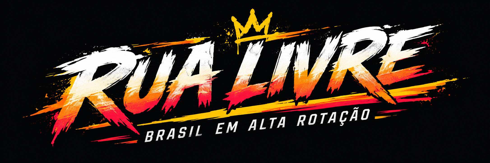
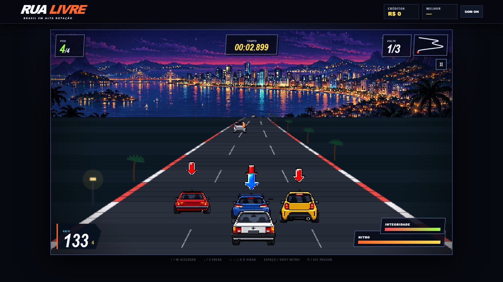
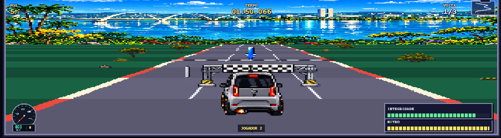
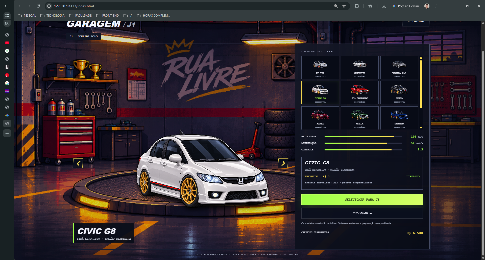

# Rua Livre: evolução do protótipo ao jogo atual



> Documento de passagem para a equipe. Ele registra o que foi modificado ou adicionado desde o primeiro protótipo, explica as mecânicas atuais e aponta o que ainda não está implementado.

**Estado documentado:** branch `main`, após o commit `139e95a`  
**Tecnologia:** HTML, CSS, JavaScript ES Modules e Canvas 2D  
**Execução:** navegador local, sem dependências de framework

---

## 1. Resumo executivo

O primeiro protótipo era uma corrida isolada em um único canvas. Ele demonstrava a ideia central, mas ainda não possuía um fluxo completo de jogo, progressão, multiplayer, cenário ambiental projetado ou uma frota ampla.

O projeto atual transformou essa base em um arcade de corrida com identidade brasileira. Hoje o Rua Livre possui:

- pista pseudo-3D com curvas, relevo e câmera próxima;
- corrida de três voltas em um circuito de 1,68 km;
- três rivais que contam para a classificação;
- doze veículos civis com velocidades diferentes;
- dez carros jogáveis;
- garagem, créditos e três estágios de preparação;
- nitro, integridade, colisões sólidas e buracos;
- modo solo e versus local com tela dividida;
- cenário de Brasília dividido em cinco trechos progressivos;
- HUD pixelado com velocímetro, minimapa, nitro e integridade;
- música original e som de motor em três camadas;
- salvamento local de créditos, carro, preparação e recordes;
- apresentação HTML navegável do projeto;
- 84 testes automatizados no estado atual.

---

## 2. Comparação visual

| Primeiro protótipo | Jogo atual |
| --- | --- |
|  |  |
| Corrida única, três carros disponíveis e interface inicial. | Motor retrabalhado, dez carros, cenário dinâmico, HUD final e multiplayer local. |

---

## 3. Protótipo inicial

O protótipo começou como uma página simples com:

- um título e instruções básicas;
- um canvas em resolução de 1280 × 720;
- controle por teclado;
- uma pista desenhada diretamente no canvas;
- uma única experiência de corrida;
- estrutura ainda concentrada em poucos arquivos.

Essa etapa serviu para validar a proposta de um jogo de corrida arcade no navegador. O trabalho seguinte concentrou-se em separar responsabilidades, melhorar a sensação de velocidade e criar um ciclo completo de jogo.

---

## 4. Como o jogo funciona hoje

### 4.1 Fluxo principal

1. **Tela inicial:** o jogador escolhe entre jogar ou entrar diretamente na garagem.
2. **Escolha do modo:** corrida solo ou versus local.
3. **Garagem:** seleção do carro do jogador 1 e, no versus, seleção independente do jogador 2.
4. **Preparação:** compra de estágio usando créditos acumulados.
5. **Corrida:** três voltas no Circuito do Cerrado, em Brasília.
6. **Resultado:** exibição da colocação, tempo, prêmio e bônus de corrida limpa.
7. **Nova tentativa:** o jogador pode correr novamente ou retornar à garagem.

### 4.2 Objetivo da corrida solo

O jogador precisa completar três voltas e buscar uma posição no pódio. Durante a prova, deve controlar a velocidade, desviar do tráfego, preservar a integridade e administrar o nitro.

### 4.3 Condições de término

- A corrida termina normalmente quando o jogador percorre a distância total das três voltas.
- A corrida termina como abandono quando a integridade chega a zero.
- O pódio considera as três primeiras posições.
- O melhor tempo e a melhor colocação ficam armazenados no navegador.

---

## 5. Controles

### 5.1 Corrida solo

| Ação | Teclas |
| --- | --- |
| Acelerar | `W` ou `↑` |
| Frear | `S` ou `↓` |
| Virar | `A` e `D` ou `←` e `→` |
| Nitro | `Espaço` ou `Shift` |
| Pausar | `P` ou `Esc` |

### 5.2 Versus local

| Jogador | Acelerar e frear | Virar | Nitro |
| --- | --- | --- | --- |
| Jogador 1 | `W` e `S` | `A` e `D` | `Espaço` |
| Jogador 2 | `↑` e `↓` | `←` e `→` | `Enter` |

---

## 6. Motor de corrida e sensação de pilotagem

### 6.1 Arquitetura modular

O código foi separado em módulos de configuração, pista, física, renderização, entrada, áudio, garagem, armazenamento e multiplayer. Essa divisão substituiu a estrutura inicial concentrada e permite alterar um sistema sem reescrever toda a corrida.

O projeto mantém um único loop principal. A simulação usa passo fixo de `1/60` de segundo, enquanto a renderização acompanha os quadros do navegador.

### 6.2 Projeção pseudo-3D

A pista passou a usar a projeção adaptada do projeto JavaScript Racer, de Jake Gordon, distribuído sob licença MIT. A integração aproveita a matemática de perspectiva, curvas e recorte de morros, mas preserva as regras, carros, HUD, áudio e identidade do Rua Livre.

Principais ganhos:

- segmentos de pista projetados em profundidade;
- curvas acumuladas e interpoladas;
- variação de relevo;
- recorte de objetos atrás de morros;
- câmera, carros e cenário usando a mesma geometria;
- suporte a múltiplas voltas sem quebrar a projeção;
- renderização interna em 320 × 180 para manter o visual 16 bits.

O código adaptado fica em `js/engines/jake-gordon.js`, com licença preservada em `vendor/javascript-racer/LICENSE`.

### 6.3 Curvas e força lateral

As curvas deslocam o carro para fora do traçado. O jogador precisa aplicar direção contrária para manter a linha. A força varia com a velocidade e com a intensidade da curva.

### 6.4 Derrapagem

A derrapagem é ativada quando o jogador freia e vira acima de 82 km/h.

Efeitos atuais:

- aumenta a resposta lateral para ajudar em curvas fechadas;
- reduz a velocidade gradualmente;
- altera o quadro visual do carro;
- ativa a animação de poeira.

### 6.5 Saída de pista e barreiras

- Fora do asfalto, o carro perde velocidade.
- Ao atingir o limite lateral, o carro sofre impacto.
- A barreira retira 5 pontos de integridade.
- O impacto reduz a velocidade e reposiciona o carro dentro da área válida.

### 6.6 Câmera

A câmera foi aproximada para aumentar a imersão. O ajuste preserva a proporção entre pista, carros e objetos laterais. No versus, cada jogador possui sua própria câmera.

---

## 7. Nitro

O nitro começou como um recurso simples e passou a integrar física, HUD, coleta e animação.

### Regras atuais

- O carro inicia com a barra cheia, equivalente a 100 pontos.
- O nitro só ativa acima de 55 km/h.
- Enquanto ativo, consome 24 pontos por segundo.
- Aumenta a aceleração em 62 unidades da simulação.
- Aumenta a velocidade máxima em 38 km/h.
- Cada garrafa coletada recupera 42 pontos, respeitando o máximo de 100.
- O carro usa um quadro visual próprio quando o nitro está ativo.
- O HUD atualiza a barra em tempo real.

Os coletáveis aparecem ao longo da distância total da corrida e usam o sprite `assets/scenery/turbo.png`.

---

## 8. Integridade, colisões e buracos

### 8.1 Integridade

Cada jogador inicia a corrida com 100 pontos de integridade. O valor nunca fica negativo. Ao chegar a zero, a corrida termina por destruição do veículo.

### 8.2 Colisões sólidas

O jogador não atravessa mais rivais, tráfego ou o outro jogador. Quando dois veículos ocupam a mesma faixa e distância:

- o carro de trás é mantido a uma distância segura;
- a velocidade é limitada pela do veículo à frente;
- o primeiro contato causa dano e redução de velocidade;
- um tempo de recarga impede que o mesmo contato cause dano em todos os quadros.

### 8.3 Danos atuais

| Fonte do impacto | Dano |
| --- | ---: |
| Outro jogador no versus | 8 |
| Rival | 8 |
| Carro civil | 12 |
| Van civil | 16 |
| Barreira lateral | 5 |
| Buraco | 6 |

### 8.4 Buracos

Os buracos ficam associados a distâncias reais da pista e aparecem nas três voltas.

- Eles alternam entre as três faixas.
- O dano acontece uma única vez por buraco.
- Um carro parado ou uma corrida pausada não ativa o impacto.
- O sprite cresce conforme se aproxima da câmera.
- O buraco respeita curvas, relevo e recorte de morros.

---

## 9. Rivais e tráfego civil

### 9.1 Rivais

A corrida possui três rivais. Eles contam para a classificação e usam velocidades alvo diferentes.

| Rival | Velocidade base aproximada |
| --- | ---: |
| Rival 1 | 172 km/h |
| Rival 2 | 164 km/h |
| Rival 3 | 156 km/h |

Os rivais:

- largam parados e aceleram progressivamente;
- mudam de faixa durante a corrida;
- reduzem levemente a velocidade em curvas;
- registram o instante em que terminam a prova;
- usam modelos visuais distintos.

### 9.2 Tráfego civil

O número de rivais permaneceu em três. O aumento solicitado foi aplicado apenas aos carros civis.

- Existem doze veículos civis simultâneos.
- Eles não contam para a colocação.
- Os perfis de velocidade partem de 60, 85, 110 e 135 km/h, com pequena variação aleatória.
- Carros ultrapassados reaparecem além da câmera.
- O reposicionamento evita gerar dois veículos quase no mesmo ponto e faixa.
- Carros e vans possuem danos diferentes.

---

## 10. Voltas, posição, cronômetro e resultado

### 10.1 Estrutura da prova

- Comprimento de uma volta: 1,68 km.
- Quantidade de voltas: 3.
- Distância total: 5,04 km.
- Contagem regressiva: 3 segundos.
- A posição considera apenas os rivais no modo solo.
- No versus, o outro jogador também entra no cálculo visual da posição.

### 10.2 Recompensas

| Resultado | Prêmio base |
| --- | ---: |
| 1º lugar | R$ 1.000 |
| 2º lugar | R$ 750 |
| 3º lugar | R$ 600 |
| 4º lugar | R$ 400 |
| Abandono por integridade | R$ 100 |

Uma corrida completa sem colisões concede **R$ 250 adicionais**.

### 10.3 Persistência do resultado

No modo solo, o jogo atualiza:

- saldo de créditos;
- melhor colocação;
- melhor tempo;
- carro escolhido;
- estágio de preparação;
- preferência de áudio.

O modo versus é amistoso e não altera créditos ou recordes.

---

## 11. Garagem e frota



### 11.1 Reformulação da garagem

A seleção simples de carro virou uma oficina completa com:

- cenário de garagem em tela inteira;
- carro em destaque sobre a plataforma;
- navegação por setas e teclado;
- miniaturas da frota;
- descrição do modelo;
- atributos de velocidade, aceleração e controle;
- créditos disponíveis;
- estado de compra;
- estágio instalado;
- ações de selecionar, comprar e preparar;
- seleção separada para jogador 1 e jogador 2.

### 11.2 Carros jogáveis atuais

1. UP TSI
2. Chevette
3. Vectra GLS
4. Civic G8
5. Gol Quadrado
6. Jetta
7. Marea
8. Opala
9. Santana
10. Uno Mille

Os três primeiros usam as folhas de sprites originais. Os sete modelos adicionados possuem recortes explícitos para direção, nitro e apresentação na garagem.

Todos os veículos atuais estão incluídos por R$ 0. A arquitetura de compra já aceita um campo `price` para futuros carros pagos com créditos.

### 11.3 Centralização e escala

Os carros Civic G8, Gol Quadrado, Jetta, Marea, Opala, Santana e Uno Mille receberam ajustes específicos para permanecer no centro da plataforma sem deformar a arte.

---

## 12. Preparação e economia

O jogo utiliza um pacote de preparação compartilhado entre os carros e jogadores.

| Estágio | Custo para instalar | Velocidade máxima | Aceleração | Controle |
| --- | ---: | ---: | ---: | ---: |
| 1/3 | Inicial | 190 km/h | 68 | 1,280 |
| 2/3 | R$ 500 | 198 km/h | 73 | 1,305 |
| 3/3 | R$ 900 | 206 km/h | 78 | 1,330 |

Regras de compra:

- a compra é bloqueada sem créditos suficientes;
- um estágio não pode ser instalado duas vezes;
- a confirmação desconta o saldo e atualiza os atributos reais;
- o save mantém o estágio entre sessões;
- o estágio 0/3 aparece apenas como referência visual indisponível;
- Motor e Pneus representam efeitos existentes;
- Acerto individual continua identificado como implementação futura e não altera a física.

---

## 13. Modos de jogo

### 13.1 Corrida solo

- Um jogador controla o carro.
- Três rivais definem a classificação.
- O tráfego civil ocupa as faixas.
- O resultado altera créditos e recordes.
- O jogador pode repetir a corrida ou retornar à garagem.

### 13.2 Versus local

O modo versus adicionou uma corrida para duas pessoas no mesmo computador.

Principais características:

- tela dividida horizontalmente;
- câmera independente para cada jogador;
- carro escolhido separadamente para J1 e J2;
- nitro, integridade, buracos e coletáveis individuais;
- rivais e tráfego compartilhados;
- colisão sólida entre os dois jogadores;
- pausa compartilhada;
- vitória para quem completar primeiro ou sobreviver à destruição do adversário;
- empate quando os dois terminam no mesmo passo de simulação;
- partida amistosa sem alteração de créditos ou recordes.

O mundo é atualizado uma vez por passo, evitando que o tráfego avance em dobro por causa das duas câmeras.

---

## 14. Brasília: Circuito do Cerrado

### 14.1 Mudança de cenário

O cenário inicial do Rio foi substituído como pista principal por Brasília. O circuito atual mantém uma única pista e divide a volta em cinco ambientes progressivos.

| Trecho | Intervalo da volta | Elementos principais |
| --- | ---: | --- |
| Cerrado | 0% a 18% | Árvores retorcidas, gramíneas, pedras, cupinzeiros e poeira |
| Avenida dos Ipês | 18% a 40% | Ipês amarelos e roxos, flores, postes e pétalas |
| Eixo Monumental | 40% a 65% | Placas, postes modernos, defensas e canteiros urbanos |
| Orla do Paranoá | 65% a 85% | Vegetação baixa, guarda-corpos, placas turísticas e lago ao fundo |
| Reta da Capital | 85% a 100% | Bandeiras, placas de distância, arquibancadas, barreiras e pórtico |

### 14.2 Sistema de cenário lateral

Os objetos ambientais não são animações CSS. Cada elemento possui posição no mundo, lado da pista, afastamento lateral, escala, âncora e camada de desenho.

O renderizador:

- associa os objetos aos segmentos da pista;
- usa a mesma perspectiva da estrada;
- aplica o deslocamento das curvas;
- aumenta a escala durante a aproximação;
- desenha elementos distantes antes dos próximos;
- remove objetos fora da câmera;
- recorta itens escondidos por morros;
- usa pixel snapping e suavização desativada quando necessário.

### 14.3 Distribuição determinística

A distribuição usa uma semente fixa. A mesma pista produz a mesma paisagem entre corridas e entre as câmeras do versus.

As zonas usam densidade, pesos por sprite, espaçamento mínimo e regras de marcos. Nos 20% finais de cada trecho, a configuração começa a misturar a zona seguinte. Isso evita trocas abruptas de vegetação.

### 14.4 Pórtico

O pórtico da Reta da Capital atravessa a pista como uma estrutura de largada e chegada. Ele é apenas visual e não interfere na lógica real que conclui a corrida.

---

## 15. HUD e interface da corrida

O HUD provisório foi substituído por artes fornecidas para o projeto.

### Elementos atuais

- posição e número de competidores;
- tempo decorrido;
- volta atual;
- minimapa com marcador dinâmico;
- velocímetro analógico pixelado;
- leitura digital de velocidade;
- indicador de marcha;
- barra de integridade;
- barra de nitro;
- mensagens de contagem, volta, coleta e buraco;
- indicação de jogador no modo versus.

O velocímetro cobre de 0 a 260 km/h e altera sua apresentação quando o nitro está ativo.

---

## 16. Tela inicial, escolha de modo e tela cheia

### 16.1 Tela inicial

A tela inicial passou a usar um background próprio em `assets/tela_inicial/background.png`.

- **Jogar:** abre a tela de escolha de modo.
- **Garagem:** entra diretamente no fluxo solo da garagem.

### 16.2 Escolha de modo

A tela usa o background e os botões fornecidos em `assets/tela_modo`.

- `botao_corrida_modo_solo.jpg` inicia o fluxo solo.
- `botao_corrida_coop.jpg` inicia o fluxo versus.

### 16.3 Corrida em tela cheia

Ao iniciar uma prova, o jogo solicita a Fullscreen API. Durante a corrida, menus externos ficam ocultos e somente a área jogável ocupa o viewport. Se o navegador bloquear a API, o jogo continua funcionando no layout normal.

---

## 17. Direção visual 8/16 bits

As alterações visuais buscaram aproximar o projeto dos arcades de corrida de 16 bits sem importar sprites ou música de jogos comerciais.

Foram adicionados ou revisados:

- resolução interna de 320 × 180;
- ampliação sem suavização;
- pista desenhada em linhas opacas para evitar frestas;
- zebras largas;
- câmera mais próxima;
- carros animados conforme direção e nitro;
- poeira de derrapagem;
- pétalas na Avenida dos Ipês;
- buracos e nitro com escala maior;
- cenário lateral duas vezes maior;
- pórtico ampliado sobre a pista;
- logo e identidade visual do Rua Livre;
- backgrounds próprios para início, modo e garagem.

---

## 18. Áudio

### 18.1 Música

A música é uma composição sintetizada original em quatro compassos. Ela usa baixo, melodia e pulso rítmico gerados com Web Audio API.

### 18.2 Motor

O som simples de oscilador foi substituído por três loops de rotação:

- baixa rotação;
- média rotação;
- alta rotação.

As camadas se misturam de acordo com velocidade, marcha e nitro. A troca de marcha provoca queda de rotação audível.

Cada um dos dez carros possui um perfil próprio de:

- altura do som;
- volume;
- filtro de timbre.

Exemplos:

- Opala recebe som mais grave e encorpado.
- Uno Mille e UP TSI recebem rotação mais aguda.
- Civic e Jetta usam perfis mais altos e limpos.

Se os WAVs falharem, o motor sintetizado anterior continua funcionando como fallback.

Os loops estão em `assets/audio/engine`, com procedência e licença CC0 documentadas no `README.md` da pasta.

No versus, o áudio do motor acompanha atualmente o carro do jogador 1.

---

## 19. Salvamento

O save utiliza `localStorage` e está na versão 4.

Dados persistidos:

- créditos;
- carro do jogador 1;
- carro do jogador 2;
- lista de veículos comprados para catálogos futuros;
- preparação;
- melhor posição;
- melhor tempo;
- áudio ligado ou desligado.

O carregamento sanitiza dados inválidos e migra saves antigos quando possível.

---

## 20. Estrutura técnica atual

| Arquivo ou pasta | Responsabilidade |
| --- | --- |
| `js/config.js` | Regras globais, frota, custos e recompensas |
| `js/track.js` | Geometria, segmentos, curvas e comprimento da pista |
| `js/engines/` | Projeção e direção adaptadas do motor de Jake Gordon |
| `js/race.js` | Estado e atualização da corrida solo |
| `js/versus.js` | Coordenação das duas simulações no multiplayer local |
| `js/renderer.js` | Pista, carros, obstáculos, partículas, cenário e HUD de canvas |
| `js/scenery/` | Manifestos, zonas, ambientes e distribuição determinística |
| `js/garage.js` | Interface da garagem e preparação |
| `js/garage-model.js` | Regras de seleção, compra e upgrade |
| `js/storage.js` | Save, migração e validação de dados |
| `js/audio.js` | Música, efeitos e motor em camadas |
| `js/input.js` | Teclado de um ou dois jogadores |
| `js/speedometer.js` | Velocímetro pixelado e leitura digital |
| `js/fullscreen.js` | Entrada e saída segura da Fullscreen API |
| `assets/` | Carros, cenários, interface, áudio e telas |
| `test/` | Testes determinísticos dos sistemas do jogo |
| `apresentacao/` | Apresentação HTML do projeto |

---

## 21. Testes e verificações

O projeto possui 84 testes automatizados no estado documentado.

Cobertura principal:

- áudio e perfis de motor;
- catálogo de carros e recortes de sprites;
- tela cheia;
- garagem, compras e preparação;
- escolha de modo;
- pista, curvas, relevo e projeção;
- buracos, dano e integridade;
- rivais e tráfego;
- colisões sólidas;
- posição, chegada e recompensa;
- cenário de Brasília e suas cinco zonas;
- velocidade e escala de cenário;
- HUD, minimapa e velocímetro;
- save e migração;
- tela inicial;
- multiplayer local;
- apresentação HTML.

Para executar:

```powershell
node --test
```

---

## 22. Limitações conhecidas

Estas limitações devem permanecer claras para a equipe:

1. **Física compartilhada entre carros:** os dez modelos possuem sprites e áudio próprios, mas ainda usam o mesmo conjunto base de desempenho. A preparação altera os atributos globalmente.
2. **Acerto individual futuro:** a categoria aparece na preparação, mas ainda não possui efeito separado na física.
3. **Som do J2:** no versus, o motor reproduz o perfil do jogador 1.
4. **Multiplayer somente local:** não existe multiplayer online.
5. **Entrada por teclado:** suporte dedicado a controles ainda não foi implementado.
6. **Um circuito jogável:** Brasília está completa. Salvador e Manaus ainda precisam de panorama, sprites e regras próprias.
7. **Economia inicial simples:** os dez carros atuais estão incluídos. O sistema aceita preços futuros, mas o catálogo ainda não exige compra.
8. **Save local ao navegador:** limpar dados do site remove o progresso.
9. **Onix RS pendente:** o carro ainda não possui assets integrados.
10. **Balanceamento em validação:** velocidades, danos, tráfego e preparação ainda podem mudar após testes com jogadores.

---

## 23. Próximos passos recomendados

### Prioridade alta

- criar atributos reais por modelo de carro;
- equilibrar velocidades, aceleração e controle;
- testar a dificuldade das três voltas com jogadores externos;
- revisar volume relativo entre música, motor e efeitos;
- adicionar suporte a controle.

### Prioridade média

- implementar um segundo motor audível no versus;
- criar efeitos próprios de pneus e colisão;
- ampliar opções de preparação sem simular atributos inexistentes;
- preparar o Onix RS quando os assets forem entregues;
- produzir cenários de Salvador e Manaus.

### Prioridade futura

- avaliar multiplayer online;
- criar mais circuitos e campeonatos;
- adicionar configuração de dificuldade;
- ampliar economia e compra de veículos;
- estudar empacotamento como aplicativo desktop.

---

## 24. Histórico cronológico das mudanças

| Commit | Mudança principal |
| --- | --- |
| `fa358dc` | Criação inicial do repositório |
| `ac68234` | Estrutura básica do projeto |
| `c9fb547` | Primeiro protótipo de corrida em canvas |
| `15f4529` | Registro do protótipo inicial |
| `ae82365` | Modularização do projeto |
| `06fa501` | Corrida arcade brasileira jogável |
| `ca56812` | UP TSI e animação do carro do jogador |
| `fc068ad` | Veículos variados para rivais e trânsito |
| `0cd2e94` | Redução do carro e progressão mais rápida da pista |
| `1e0740c` | Escala igualada e colisão sólida |
| `0962ccf` | Três rivais e setas de identificação |
| `40ebcc1` | Seleção de carros jogáveis |
| `6313c19` | Logotipo do Rua Livre |
| `9101e78` | Instruções da tela de ajuda atualizadas |
| `2aa8dd5` | Sensação de velocidade e perspectiva arcade reforçadas |
| `1919cfd` | Experiência visual e sonora de 16 bits |
| `b5e5e44` | Início da adaptação do motor de Jake Gordon |
| `b8e04c2` | Motor adaptado conectado à corrida |
| `96da1e9` | Doze carros civis com velocidades variadas |
| `6ecf819` | Velocímetro pixelado e leitura digital |
| `53c9437` | Câmera aproximada |
| `475ee18` | Buracos com dano à integridade |
| `24d4273` | Versus local com tela dividida |
| `6e44e1f` | Nova garagem, seleção de modo e preparação |
| `f3d5070` | Background da garagem em tela inteira |
| `744f106` | Cenário dinâmico de Brasília em perspectiva |
| `2a44ce7` | Cinco trechos temáticos progressivos |
| `695deeb` | Sprites de pista, partículas e novo painel da corrida |
| `7b7a6d8` | Buraco e nitro ampliados |
| `1deee94` | Cenários laterais e pórtico ampliados |
| `04396cd` | Sete novos carros jogáveis |
| `b633f11` | Imagens de maior qualidade na garagem |
| `7801dc2` | Nova tela inicial e acesso direto à garagem |
| `4d19a80` | Corrida em tela cheia |
| `c8e79eb` | Nova tela de escolha de modo |
| `e8912c9` | Centralização dos novos carros na plataforma |
| `0bd2359` | Atualização geral dos recursos visuais |
| `a90df66` | Som dinâmico de motor em três camadas |
| `139e95a` | Apresentação HTML interativa do projeto |

---

## 25. Como executar o projeto

Na raiz do repositório:

```powershell
npm.cmd run dev
```

Jogo:

```text
http://127.0.0.1:4173/index.html
```

Apresentação:

```text
http://127.0.0.1:4173/apresentacao/index.html
```

---

## 26. Diretrizes para futuras alterações

- Preservar o único loop principal de jogo.
- Não criar uma segunda câmera ou física concorrente.
- Manter cenário, carros e pista na mesma projeção.
- Adicionar novas regras em módulos existentes quando possível.
- Não alterar a física para representar uma melhoria apenas visual.
- Manter o save compatível ou criar migração explícita.
- Adicionar teste para cada mecânica nova ou correção relevante.
- Documentar a licença de qualquer asset ou código externo.
- Criar commits em português com acentuação correta.
- Validar solo e versus após mudanças na corrida.

---

## 27. Referências e licenças

- Motor de projeção adaptado de [JavaScript Racer](https://github.com/jakesgordon/javascript-racer), por Jake Gordon, licença MIT.
- A licença preservada do motor fica em `vendor/javascript-racer/LICENSE`.
- Os loops de motor vieram de [racing car engine sound loops](https://opengameart.org/content/racing-car-engine-sound-loops), por domasx2, licença CC0 1.0.
- A música, os carros do Rua Livre, os cenários e a interface permanecem separados dos materiais comerciais usados apenas como referência visual.

Este documento deve ser atualizado sempre que uma nova mecânica, tela, carro, mapa ou regra econômica entrar na branch `main`.
